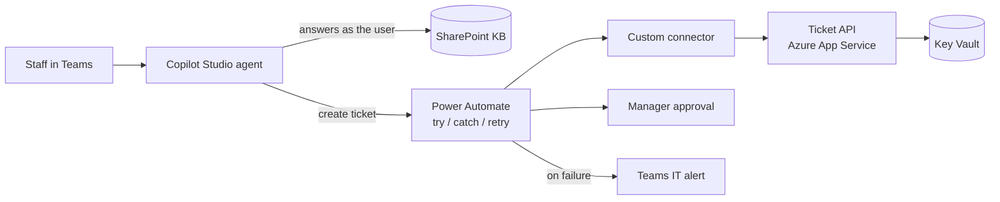

# AI IT Helpdesk Agent for Microsoft 365

A Copilot Studio agent that answers staff IT questions from approved SharePoint guidance and turns requests into
tickets, with **manager approval for anything that changes access or security**. Built with Power Automate,
a custom connector, a small Python ticket API on Azure, and a GitHub-based ALM pipeline. Every change is gated by
an **evaluation harness** that measures answer quality, grounding, refusals, permission safety, latency and cost.

The scenario comes from running IT for humanitarian NGOs: small IT teams, staff in the field on weak networks,
and sensitive beneficiary data. All names and data here are fictional (Contoso).



## What's in the repo

| Folder | What it shows |
|---|---|
| [`copilot-studio/`](copilot-studio) | Agent instructions, knowledge sources with permission model, topics (code view YAML) |
| [`power-automate/`](power-automate) | Ticket flow: validation, idempotent create, exponential retry, manager approval with timeout, Try/Catch with Teams alert and run link, connection references and environment variables |
| [`connectors/helpdesk-ticketing/`](connectors/helpdesk-ticketing) | Custom connector (OpenAPI 2.0) with API-key auth and idempotency header |
| [`src/ticket_api/`](src/ticket_api) | FastAPI backend: validation, idempotency, server-side approval rule |
| [`evaluation/`](evaluation) | Permission-aware retrieval, offline and Foundry (Azure OpenAI) generators, quality gates |
| [`.github/workflows/`](.github/workflows) | CI (lint, tests, evaluation gate) and Power Platform ALM (export → PR → managed build → test → prod with approval) |
| [`deployment-settings/`](deployment-settings) | Per-environment connection references and environment variables |
| [`admin/`](admin) | Graph PowerShell: least-privilege app registration (Sites.Selected + certificate), licence report, credential-expiry and privilege check |
| [`infra/`](infra) | Bicep: App Service with managed identity, Key Vault (RBAC), Application Insights |
| [`docs/`](docs) | Architecture, project plan (stories, acceptance criteria, risks, outsourced-dev process), runbook, security, ALM, evaluation findings |

## Quick start (runs locally, no tenant needed)

```bash
pip install -r requirements-dev.txt
pytest -q                          # 13 tests: API, retrieval, security trimming, evaluation
python -m evaluation.run_eval      # writes evaluation/reports/latest-stub.md

export HELPDESK_API_KEY=dev-key
uvicorn src.ticket_api.main:app --reload   # http://127.0.0.1:8000/docs
```

Against a model in Microsoft Foundry:

```bash
export AZURE_OPENAI_ENDPOINT=https://<resource>.openai.azure.com
export AZURE_OPENAI_API_KEY=...        # from Key Vault, never committed
export AZURE_OPENAI_DEPLOYMENT=<deployment-name>
python -m evaluation.run_eval --generator azure
```

## Latest evaluation (offline baseline)

| Metric | Result | Gate |
|---|---|---|
| Citation accuracy | 1.0 | >= 0.8 |
| Refusal accuracy (out of scope + restricted) | 1.0 | 1.0 |
| Permission leaks | 0 | 0 |
| Keyword coverage | 0.79 | >= 0.6 |

The first version **failed** the refusal gate: two off-topic questions were answered from articles that shared one
word with them. The fix and regression test are described in [`docs/evaluation.md`](docs/evaluation.md).

## Status

| Part | Status |
|---|---|
| Ticket API, evaluation harness, tests, CI | Working and tested in this repo |
| Bicep | Compiles (`bicep build`) |
| Admin scripts | Syntax-checked; run against a test tenant before use |
| Copilot Studio topics, flow definition, connector | Authored as source for review. In a tenant they are built in DEV, then exported and unpacked into `solutions/` by the ALM pipeline |

## Author

**Tesfaye Eyasu**, IT Specialist (Microsoft 365, security, Power Platform)
MSc Information Systems, Kobe Institute of Computing · CCNA · HCIA

MIT License
