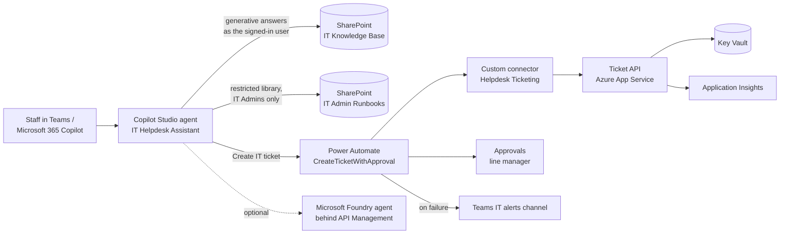

# Architecture

## Components

| Component | Technology | Why |
|---|---|---|
| Conversational front end | Copilot Studio agent in Teams and Microsoft 365 Copilot | Where staff already work; Entra sign-in gives the user's identity |
| Knowledge | SharePoint libraries | Content owners keep articles current; permissions are the source of truth for who sees what |
| Actions | Power Automate flow | Low-code, auditable, with approvals and Teams alerts built in |
| Integration | Custom connector (OpenAPI) | Reusable by any flow or agent; API key managed per environment |
| Backend | Python FastAPI on App Service | Small, testable; idempotent create; server-side approval rule |
| Secrets and monitoring | Key Vault, Application Insights, Log Analytics | No secrets in flows or code; one place for telemetry |
| Quality | `evaluation/` harness in CI | Answer quality, grounding, refusals, permission leaks, latency and cost are measured on every change |

## Key design decisions

1. **The agent acts as the signed-in user.** SharePoint security trimming decides what each person can be answered from; the agent never has broader access than the user.
2. **Approvals are enforced twice.** The flow asks the manager, and the API refuses to open a high-risk ticket without an approval ID. A broken or bypassed flow cannot skip the rule.
3. **Refuse rather than guess.** If retrieval finds nothing relevant enough, the agent offers a ticket. The evaluation gate fails the build if any out-of-scope question gets an answer.
4. **Everything environment-specific is a parameter** (connection references, environment variables, deployment settings), so one managed solution moves from test to prod unchanged.
