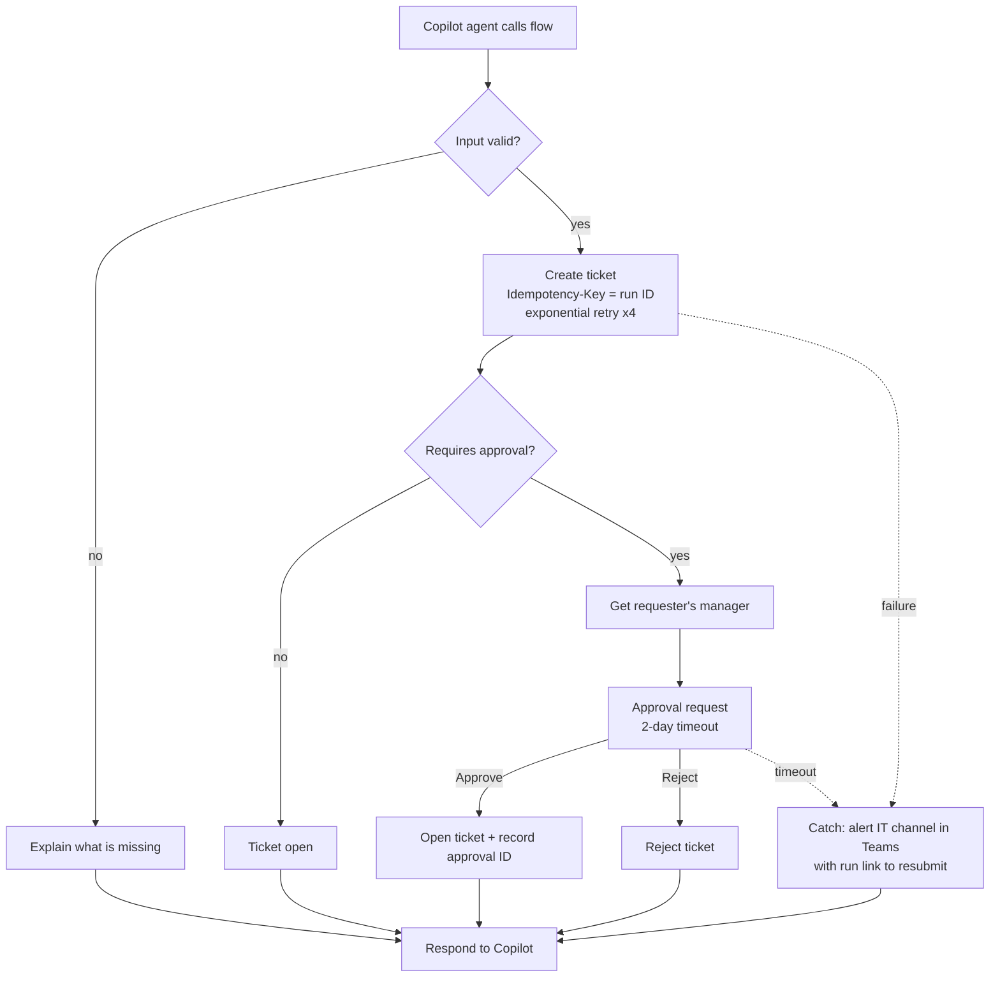

# Power Automate: Create Ticket With Approval

`CreateTicketWithApproval.json` is the flow the Copilot Studio agent calls when a user needs a ticket.
It is written in the Logic Apps workflow definition language that Power Automate uses, with
connection references and environment variables so the same flow deploys unchanged to dev, test and prod.

## What it does

## Reliability decisions

| Concern | How it is handled |
|---|---|
| Bad input from the conversation | Validated before any call; the user is told exactly what is missing |
| Transient API errors | Exponential retry (4 attempts, 10 s base, 2 min max) |
| Duplicate tickets on retry or resubmit | `Idempotency-Key` header = flow run ID; the API returns the existing ticket |
| Risky actions (access, MFA, security) | Ticket held in `PendingApproval`; line manager must approve; the API also refuses to open it without an approval ID, so the rule holds even if the flow is bypassed |
| Approver never answers | 2-day timeout routes to the Catch scope and alerts IT |
| Any other failure | `Try`/`Catch` scopes; IT gets a Teams alert with the error and a direct link to the run so it can be resubmitted |
| The user is never left hanging | `Respond to Copilot` runs after success, handled failure or skipped catch |

## Connection references and environment variables

| Name | Type | Notes |
|---|---|---|
| `cr_HelpdeskTicketing` | Connection reference | Custom connector in `connectors/helpdesk-ticketing` |
| `cr_Approvals` | Connection reference | Approvals |
| `cr_Office365Users` | Connection reference | Manager lookup |
| `cr_Teams` | Connection reference | IT alert channel |
| `cr_ITAlertsTeamId`, `cr_ITAlertsChannelId` | Environment variables | Different channel per environment |

Values per environment live in `deployment-settings/`, so nothing environment-specific is hard-coded in the flow.

> Note: this definition is authored for review in source control. In a tenant, the flow is part of the
> `HelpdeskAgent` solution and is exported and unpacked by the ALM pipeline (`.github/workflows/power-platform-alm.yml`).
